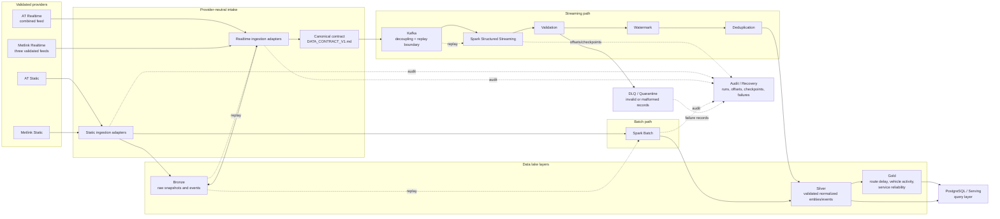

# Day 6 Architecture

## 1. Purpose and Scope

This document defines the Day 6 architecture for the Real-Time Transport Data Lakehouse MVP. It describes how the already validated Auckland Transport (AT) and Metlink / Greater Wellington sources enter provider-neutral batch and streaming paths.

This is an architecture design, not an implementation. It does not create Kafka, Spark, S3, PostgreSQL, Docker, API clients, or production code.

The architecture is constrained by the Day 3 and Day 4 evidence:

- AT Static is available as GTFS CSV files and AT Realtime returned a combined JSON feed containing Trip Updates, Vehicle Positions, and Service Alerts.
- Metlink Static is available as GTFS files and the three documented Realtime endpoints returned valid JSON with the corresponding entity categories.
- Metlink Realtime field-level compatibility beyond endpoint/entity presence was not verified.
- Provider-specific fields remain in raw/provider extension data unless the canonical contract justifies promotion.

## 2. Architecture Overview



The PNG companion, [architecture.png](architecture.png), is a static rendering of this logical view. The diagram is intentionally logical: deployment topology, partition counts, file paths, and resource sizes are not fixed on Day 6.

## 3. System Components

| Component                  | Responsibility                                                                                                             | Day 6 boundary                                                                                                                                      |
| -------------------------- | -------------------------------------------------------------------------------------------------------------------------- | --------------------------------------------------------------------------------------------------------------------------------------------------- |
| AT Static source           | Supplies planned routes, trips, stops, stop times, calendars, and shapes.                                                  | Source capability verified in the local AT snapshot. No new source request is part of this work.                                                    |
| AT Realtime source         | Supplies a combined feed containing Trip Updates, Vehicle Positions, and Service Alerts.                                   | One validated JSON request established the envelope and entity categories. Refresh, quota, and long-term availability remain operational follow-up. |
| Metlink Static source      | Supplies the planned Wellington-area network and schedule.                                                                 | Local Static download and core schema compatibility with AT were verified. Provider-specific files remain extensions.                               |
| Metlink Realtime source    | Supplies the three required Realtime categories through separate documented endpoints.                                     | One authenticated validation per endpoint established HTTP 200 and valid JSON/entity presence. Cross-provider field mapping remains open.           |
| Provider adapters          | Read each provider's verified input shape and attach provider provenance.                                                  | Future implementation boundary; adapters must not assume identical optional fields.                                                                 |
| Canonical contract         | Defines provider-neutral event names, fields, identifier scope, timestamp semantics, and identity rules.                   | [DATA_CONTRACT_V1.md](DATA_CONTRACT_V1.md) is the contract authority.                                                                               |
| Bronze                     | Preserves raw Static snapshots and raw Realtime payloads/snapshots with ingestion/provenance metadata.                     | Replayable source record; no business aggregation.                                                                                                  |
| Spark Batch                | Parses and normalizes Static snapshots, applies batch validation, and creates Silver entities.                             | Planned batch processing component; not implemented yet.                                                                                            |
| Kafka                      | Decouples Realtime ingestion from downstream processing and retains an event stream boundary for replay.                   | Logical role only; topic names and partition counts are future implementation decisions.                                                            |
| Spark Structured Streaming | Consumes canonical events, validates them, handles event-time processing, and writes Silver outputs.                       | Logical streaming processor only.                                                                                                                   |
| Validation                 | Applies contract, type, nullability, identifier, referential, and geographic checks where applicable.                      | Invalid records do not proceed to normal Silver/Gold outputs.                                                                                       |
| Watermark                  | Bounds event-time state for late/out-of-order Realtime processing.                                                         | Policy values are not defined on Day 6.                                                                                                             |
| Deduplication              | Applies the event identities defined in the canonical contract.                                                            | Unresolved identities are observable/quarantined, not silently guessed.                                                                             |
| DLQ / Quarantine           | Holds malformed, unparseable, invalid, or identity-unresolved records with failure reason and provenance.                  | Logical failure path; retention and schema are future implementation decisions.                                                                     |
| Audit / Recovery           | Records run status, counts, failures, processing latency, offsets, and checkpoints needed to explain or resume processing. | Supports recovery evidence; not an enterprise disaster-recovery claim.                                                                              |
| PostgreSQL / Serving       | Provides query-oriented serving for selected Silver/Gold outputs and project demonstration queries.                        | Serving/query layer only, not the primary lake storage.                                                                                             |

## 4. Provider Abstraction

Both providers enter the same logical architecture, but they do not share an assumed identical source schema.

```text
AT Static + AT Realtime ---------\
                                  -> provider adapter -> provenance -> canonical contract
Metlink Static + Metlink Realtime /
```

The provider abstraction follows these rules:

1. `source_provider` is attached before canonical processing and remains part of the identifier namespace.
2. Static core relationships are normalized around `route_id`, `trip_id`, `stop_id`, `stop_sequence`, `service_id`, and `shape_id`.
3. Realtime is normalized only into the three canonical event types: `vehicle_position`, `trip_update`, and `service_alert`.
4. Optional or provider-specific fields are retained in Bronze/provider extensions rather than forced into the canonical model.
5. AT's combined Realtime envelope and Metlink's separate endpoint responses are adapter differences, not differences in the canonical event vocabulary.
6. No route is inferred from `vehicle_id`, and no Vehicle Position `stop_id` is invented from coordinates.

## 5. Batch Flow

```text
AT Static -----------------------\
                                  -> Static ingestion -> Bronze
Metlink Static ------------------/                         |
                                                           v
                                                   Spark Batch
                                                           |
                                      parse -> normalize -> validate
                                                           |
                                                           v
                                                        Silver
                                                           |
                                                           v
                                                         Gold
                                                           |
                                                 PostgreSQL / Serving
```

### 5.1 Static ingestion and Bronze

Static ingestion accepts the existing provider files and records the source/provider and snapshot metadata. Bronze preserves the original files or snapshots so a later transformation can be reproduced without re-fetching the source.

Bronze responsibilities:

- Preserve raw GTFS CSV/text content and source snapshot context.
- Preserve provider-specific columns such as AT `contract_id` or Metlink `etm_id`.
- Record fetch/ingestion metadata without treating feed dates or row counts as permanent guarantees.
- Provide a replay input for parsing and batch recovery.

### 5.2 Spark Batch and Silver

Spark Batch reads Bronze Static data, validates file and field structure, and creates normalized Silver entities. The core Static relationship remains:

```text
routes.route_id -> trips.route_id
trips.trip_id -> stop_times.trip_id
stop_times.stop_id -> stops.stop_id
```

Silver responsibilities:

- Represent validated routes, trips, stops, stop times, calendars, and shapes.
- Retain provider scope for identifiers.
- Apply nullability, type, uniqueness, referential, and applicable geographic checks.
- Keep raw/provider-specific fields available without making them canonical.
- Provide the reference data needed to interpret Realtime events.

### 5.3 Gold and serving

Gold contains business-facing results derived from validated Silver data, such as:

- Route delay metrics.
- Vehicle activity.
- Service reliability.

PostgreSQL is a query and serving layer for selected Silver/Gold outputs. The data lake layers remain the primary analytical and replay-oriented storage boundary; PostgreSQL is not the source of truth for raw snapshots or the full event history.

## 6. Streaming Flow

```text
AT Realtime + Metlink Realtime
             |
             v
     Realtime provider adapters
             |
             v
     Canonical Events
             |
             v
 Kafka: decoupling + replay boundary
             |
             v
 Spark Structured Streaming
             |
             v
 Validation -> Watermark -> Deduplication
             |                 |
             |                 +--> unresolved identity -> Quarantine
             +----------------------> malformed/invalid -> DLQ
             |
             v
          Silver
             |
             v
           Gold
             |
             v
    PostgreSQL / Serving
```

### 6.1 Realtime ingestion and canonicalization

The adapters consume the already validated source shapes and map them to the contract in [DATA_CONTRACT_V1.md](DATA_CONTRACT_V1.md). They attach `source_provider`, preserve `source_entity_id` when available, and assign the project ingestion timestamp. They do not re-test the APIs as part of this architecture work.

AT evidence supports a combined feed containing all three event categories. Metlink evidence supports three separate JSON endpoints and the corresponding entity categories, but not complete field-level parity. Therefore the Metlink adapter may produce nullable canonical fields until an explicit later validation establishes the mapping.

### 6.2 Kafka boundary

Kafka is the decoupling boundary between source ingestion and stream processing:

- Ingestion can accept and publish events without coupling directly to Spark processing progress.
- Consumer offsets provide a restart position for downstream processing.
- Retained events can be replayed for recovery, testing, or a revised canonical transformation, subject to source retention permissions.
- At-least-once delivery is the project baseline, so downstream validation and deduplication are required.

Topic names, partition counts, retention settings, and keying are intentionally deferred to the Kafka implementation day.

### 6.3 Validation, watermark, and deduplication

Spark Structured Streaming performs the following logical stages:

1. **Validation**: parse the canonical envelope, check required fields and types, and apply provider-scoped referential checks against Silver Static data where available.
2. **Watermark**: use `event_ts` for event-time state and bound late-event state. The duration is not defined yet.
3. **Deduplication**: apply the event identities from the canonical contract. Do not deduplicate by route, vehicle, or trip alone.
4. **Silver write**: write accepted normalized events, preserving provenance and the original event identity.
5. **Gold derivation**: calculate route delay, vehicle activity, and service reliability products from accepted Silver data.

A missing `event_ts` is not silently replaced with `ingest_ts`. Events without a reliable identity are marked unresolved or quarantined according to the future implementation policy.

## 7. Failure Path

```text
source/parse/schema/reference failure
                  |
                  v
        DLQ / Quarantine
                  |
       failure reason + provenance
                  |
        audit record / operator review
```

Invalid or malformed records must not contaminate normal Silver or Gold outputs. The failure path covers:

- Invalid JSON or unsupported source structure.
- Missing required canonical fields.
- Type or nullability violations.
- Invalid coordinates where coordinates are present.
- Unresolved or unsupported event identity.
- Static referential mismatch for a supplied provider-scoped identifier.
- Source outage, authentication failure, timeout, or temporary unavailability as an ingestion failure state rather than a fabricated data event.

The exact DLQ storage format, retry policy, alerting, and retention are not defined on Day 6.

## 8. Audit and Recovery

Audit is a cross-cutting path rather than a business data layer. It records enough operational context to explain what happened and to resume or replay work:

- Pipeline/run identifier, provider, source category, and ingestion time.
- Records read, accepted, rejected, quarantined, and written.
- Failure reason counts and processing latency.
- Kafka topic/partition/offset progress for streaming work.
- Spark checkpoint location/state for restart recovery.
- Source snapshot or Bronze reference used for batch replay.

### Recovery concepts

- **Batch recovery**: restart Spark Batch from a preserved Bronze Static snapshot rather than requiring a new provider request.
- **Streaming recovery**: restart from Spark checkpoints and Kafka offsets; reprocessing is expected to be safe only when validation and canonical deduplication are applied.
- **Controlled replay**: read retained Bronze events or Kafka records through the same canonical contract and processing path.
- **Source outage**: record the outage and preserve the last valid data; do not synthesize transport events.

This is scoped recovery for a local-first demonstrable platform, not a claim of enterprise disaster recovery or source availability.

## 9. Data Layer Responsibilities

| Layer                | Primary responsibility                                                                               | Must not do                                                           |
| -------------------- | ---------------------------------------------------------------------------------------------------- | --------------------------------------------------------------------- |
| Bronze               | Preserve raw Static snapshots and raw Realtime payloads/events with provenance for audit and replay. | Do not present raw data as validated business data.                   |
| Silver               | Store validated, normalized Static entities and canonical Realtime events.                           | Do not contain records that failed the applicable contract/DQ checks. |
| Gold                 | Store derived business outputs such as route delay, vehicle activity, and service reliability.       | Do not become the only copy of raw or canonical event history.        |
| PostgreSQL / Serving | Support query-oriented access to selected refined outputs.                                           | Do not replace Bronze/Silver/Gold as primary lake storage.            |

The planned cloud lake may use S3 and Parquet as described in the project charter, while the MVP remains local-first. The architecture does not require a cloud runtime for the core demonstration.

## 10. Major Design Decisions

1. **Two providers, one canonical vocabulary**: AT and Metlink are both represented, while provider differences remain at the adapter and extension boundaries.
2. **Static is the reference domain**: routes, trips, stops, and scheduled stop times explain Realtime identifiers and predictions.
3. **Kafka separates availability from processing**: source ingestion and Spark consumption can progress and recover independently.
4. **Bronze is replay-oriented**: raw inputs are preserved before normalization so transformations can be rerun without depending on a live API.
5. **Silver is the quality boundary**: only validated and normalized records proceed to business outputs.
6. **Event time is distinct from ingestion time**: late and out-of-order processing requires source event time when available; ingestion time is not a substitute.
7. **Deduplication follows the contract**: source/provider identity and event context are used only when supported; unresolved identities are not guessed.
8. **PostgreSQL is serving, not lake storage**: query convenience does not replace raw, canonical, and analytical lake layers.
9. **Local-first execution**: the architecture supports a reproducible local MVP, with S3 as an optional cloud lake integration rather than a prerequisite for core computation.
10. **No unsupported provider claims**: Metlink's validated capability is limited to the documented Static compatibility and the observed Realtime endpoint/entity/JSON results; further field-level normalization requires later evidence.

## 11. Deferred Implementation Decisions

The following remain outside Day 6:

- Kafka topic names, keys, partition counts, retention, and security configuration.
- Spark cluster/runtime configuration, checkpoint paths, watermark durations, and window definitions.
- Bronze/Silver/Gold physical paths, file sizes, partition columns, and Parquet options.
- PostgreSQL table DDL, indexes, refresh strategy, and serving API.
- Retry/backoff policy, DLQ schema, alerting, and operational dashboards.
- Exact timezone and timestamp precision normalization.
- Repeated-request source monitoring, provider quotas, replay permissions, and long-term retention policy.
- Complete Metlink Realtime field-level mapping and cross-provider enum mapping.

These decisions should be made during implementation using the evidence and constraints recorded in the Day 2/3/4 documents and the canonical contract.
